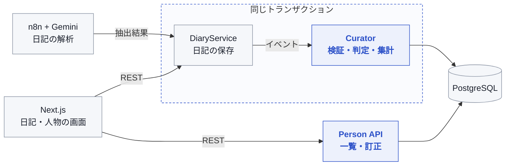
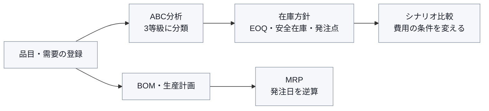

# 朱 韓榮 ｜ JU HAN YOUNG

**バックエンドエンジニア志望**

*業務のルールを、正しく動くデータと計算に。*

 

 

---

## 👋 About

大学で **物流学** を学び、在庫・発注・資材計画といった「業務のルール」に触れてきました。 
そのルールを、**データがずれず、計算が正しく、あとから根拠を説明できる** システムとして実装することに関心があり、バックエンドエンジニアを目指しています。

| | |
| --- | --- |
| 🎓 **学歴** | 慶星大学校（韓国・釜山）経済物流学部 物流学科 卒業（2025.02） |
| 💻 **研修** | Data Science Academy「Smart Cloud IT マスター AX/DX」日本 SW Developer 課程（2026.11 修了予定） |
| 🎯 **志望** | 日本の IT 企業でのバックエンド開発 |

---

## 🛠 Tech Stack

| 分野 | 技術 |
| --- | --- |
| Backend | `Java 17 / 21` `Spring Boot` `Spring Data JPA` `Spring Security` |
| Database | `PostgreSQL` `H2（テスト）` |
| Test / CI | `JUnit 5` `Mockito` `AssertJ` `GitHub Actions` |
| Frontend | `React` `Next.js` `TypeScript` `TanStack Query` `Tailwind CSS` |

---

## 📔 TADA ｜ AIダイアリーアプリ

> **チーム開発（5名）** · 2026.08 – 09 · 担当：人物キュレーター（API・画面）

日記を書くと、AIがステッカーを作ってカレンダーに残すサービスです。 
日記に出てくる人物を判定し、人ごとに日記をまとめる機能を担当しました。

🟦 青い部分が担当範囲

#### ✨ 取り組んだこと

| | 内容 |
| --- | --- |
| **人物判定** | 似た名前を誤ってまとめない4段階の判定（EXACT → SIMILAR → 履歴 → NEW） |
| **整合性** | 日記の保存と人物データを同じトランザクションで処理し、片方だけ残らないようにする |
| **同時保存** | 人物の行をロックしてから読み、上書きと主キーの衝突を防ぐ |
| **訂正・修正** | AIの候補と確定した人物を分離、本文修正は KEEP / ADD / REMOVE |
| **テスト** | 128件（人物判定 74件） |

📖 **詳しい説明** ▸ [**TADA README（日本語）**](https://github.com/hanyx-00/tada-was#readme) 
🔗 **Code** ▸ [Backend（Curator）](https://github.com/hanyx-00/tada-was/tree/main/src/main/java/com/tada/tada/curator) · [Frontend（Curator）](https://github.com/hanyx-00/tada-frontend/tree/main/domains/curator)　|　**Demo** ▸ [tada-frontend-seven.vercel.app](https://tada-frontend-seven.vercel.app)

---

## 📦 RESTOCK ｜ 在庫発注シミュレーター

> **個人開発** · 2026.09 · 担当：設計から画面・CIまですべて

需要の履歴から、在庫の発注量と発注日を計算するサービスです。 
物流学科で学んだ ABC分析・EOQ・安全在庫・MRP を、バックエンドから画面まで実装しました。

#### ✨ 取り組んだこと

| | 内容 |
| --- | --- |
| **安全在庫** | ABC等級に応じて基準（サービス水準）を変える |
| **MRP** | 部品構成と生産計画から、発注日を逆算する |
| **正確さ** | `BigDecimal` で計算、うるう年・需要0の日も考慮 |
| **検証** | 計算のテストと手計算で結果を照合、GitHub Actions で自動チェック |
| **構成** | Java 21 · Spring Boot 4.1 · PostgreSQL · React 19 |

📖 **詳しい説明** ▸ [**RESTOCK README**](https://github.com/hanyx-00/restock#readme)　|　🔗 **Code** ▸ [restock](https://github.com/hanyx-00/restock)

---

## 💡 開発で大切にしていること

1. **業務のルールを先に整理する** — 入力・単位・判断の条件を決めてから実装する
2. **データの整合性を守る** — 訂正や同時保存のあとも、数がずれない構造にする
3. **結果を確かめる** — テスト・手計算で、判断の根拠を残す

---

📫 **Contact** ▸ a98220919@gmail.com

